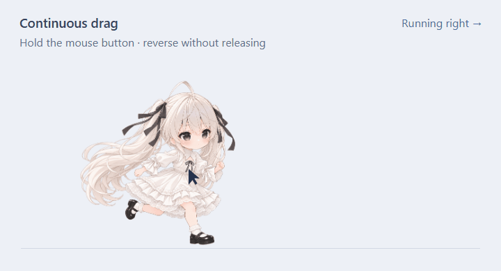

# Codex Desktop Pet

Author: **CharlesQueen**

English · [简体中文](README.zh-CN.md)

A customizable Codex desktop pet plugin with a transparent floating window, native-resolution animation, and automatic work-state following.


The pictured character is one example pack. The plugin’s identity and animation controls are independent of that character. See [artwork rights](assets/RIGHTS.md).

## What's new in 0.2.2

- **Smoother waiting animation:** six new in-between poses create a 20-frame tilt-and-return loop, with refined lace details and aligned positioning.
- **Wider idle gaze:** the pet follows the mouse around its window, extending about 40 pixels beyond it at the default size. Work animations keep priority.
- **Turn while dragging:** reversing the mouse direction turns the running animation immediately after a small movement threshold, without releasing the mouse or crossing the starting point.

### Waiting animation


### Continuous drag and direction changes



The drag demo uses the desktop renderer with scripted pointer movement. GIF previews are reduced in size; the installed animation retains its **1422 × 1117** canvas.

## Features

- Transparent, always-on-top Windows companion; drag to move, use **Ctrl + wheel** or **− / +** to resize.
- Automatic appearance when the local plugin connects, one shared window across connections, and exit after the last connection ends.
- Work, waiting, completion and failure states from local Codex lifecycle hooks; temporary actions can also be set through MCP tools.
- Nine standard action states, plus sixteen look directions. The supplied pack contains 112 playback frames, including six generated in-between images used in both directions of the waiting animation on a shared **1422 × 1117** canvas.
- Character and outfit packs driven by `assets/manifest.json`; English and Chinese UI selection in the panel and tray menu.
- **Escape** collapses controls. Closing the pet hides it to the tray; **Exit pet** ends it.

This is a separate native renderer connected to a local Codex plugin. It does not replace the built-in **Show pet** renderer. Windows is the tested platform. Local lifecycle hooks require a compatible Codex host; cloud Work environments do not provide the same local hook connection.

## Download and install

Download the [latest release](https://github.com/CharlesQueen/codex-desktop-pet/releases/latest), or clone this repository. Releases contain source and the existing artwork; they are not standalone installers.

Requirements: Windows, Node.js 22.12 or later, pnpm 11, and a Codex desktop installation with local plugin support.

```powershell
git clone https://github.com/CharlesQueen/codex-desktop-pet.git
cd codex-desktop-pet
powershell -NoProfile -ExecutionPolicy Bypass -File scripts/install.ps1
```

The installer installs dependencies, explicitly downloads the Electron runtime, configures this checkout, builds and registers the plugin, then immediately opens the pet without waiting for MCP. It reports success only after a fresh window report confirms visibility and rendered artwork. Startup diagnostics are saved in `.local/desktop/startup.log`. Keep this checkout in place while the installed plugin uses its runtime.

Reload Codex and enable lifecycle callbacks when prompted to start automatic work-state following. The initial window stays open without a connection; once MCP connects, the existing window switches to managed mode and exits after the last connection ends. Run `pnpm desktop:start` to show the pet again, or `pnpm desktop` for foreground debugging. `pnpm preview` prints a local panel preview URL.

Installing only through `codex plugin add` registers the plugin but does not run this installer or show a window immediately. Use the setup command above for install-and-show behavior (or `pnpm run setup` after cloning).

## Controls and language

Right-click the character or tray icon for automatic following, action previews, outfit selection and **Language → English / 中文**. The conversation panel has its own language selector. Available outfits come from the manifest; only the white-dress example is included.

`pet_open` returns a session ID. Pass that ID to `pet_status` and `pet_set_state` to keep different chats isolated. `running` means focused work; `running-left` and `running-right` mean movement. `mode: "auto"` releases a temporary action.

## Add your own character or outfit

1. Add a pack at `assets/<pack-id>/` with `<state>.png` animated PNGs and `<state>-still.png` stills. Keep the same canvas and character registration for every state.
2. Supply `look/00.png` through `look/15.png` in clockwise order starting from up.
3. Add the pack’s `id`, Chinese `label` and English `label_en` under `outfits` in `assets/manifest.json`. Select the initial pack with `default_outfit`.
4. Update `canvas`, frame counts, durations and SHA-256 metadata to match your resources; rebuild the plugin.

State names: `idle`, `running-right`, `running-left`, `waving`, `jumping`, `failed`, `waiting`, `running`, `review`, `looking`. For the supplied example, the first nine states contain 96 playback frames and the look set contains 16. All packs currently share the manifest’s canvas and animation metadata.

## Updating an existing installation

Exit Codex and choose **Exit pet** from the tray menu. Open PowerShell in your existing repository directory and fetch the update:

```powershell
git pull --ff-only
```

After it succeeds, refresh the installed plugin:

```powershell
powershell -NoProfile -ExecutionPolicy Bypass -File scripts/update.ps1
```

The update rebuilds the plugin and replaces its installed cache, then opens the updated pet. Window settings and local session data stay in `.local`. Reopen Codex to reconnect automatic work-state following. Updating only the Git checkout does not refresh the installed plugin cache.

For ZIP installations, extract the new source files into the existing directory while keeping `.local`, then run the same update command. Commit or stash your own source changes before pulling a Git update.

## Development

```powershell
pnpm test
pnpm desktop:test
pnpm test:lifecycle
pnpm test:pointer
pnpm test:update
pnpm exec playwright install chromium
pnpm test:browser
pnpm format
```

The tests cover session isolation, concurrent callback writes, explicit failure states, MCP image transport, native-window controls, connection lifetime and the bilingual panel. Native tests open isolated test windows. Runtime state, test captures, local paths, dependencies and generated release folders are excluded from Git.

## Repository access

Anyone may download or copy the repository under its license. Only collaborators explicitly invited by the owner may open pull requests. Creating, updating, deleting or merging branches in the original repository is reserved to the owner. Automatic merging is disabled. An invitation does not grant permission to bypass these branch restrictions.

## License and responsibility

Original code and documentation: [PolyForm Noncommercial 1.0.0](LICENSE.md). This is **source-available, noncommercial software**, not an OSI open-source project. Noncommercial modification and sharing are permitted under that license, with the required notices preserved. Commercial use is not permitted. Example artwork and third-party IP have [separate terms](assets/RIGHTS.md).

This project is provided solely for noncommercial learning, discussion, and sharing. The author assumes no liability whatsoever for others’ use in violation of the license or third-party rights, or for any resulting consequences.

See [NOTICE.md](NOTICE.md) for the required copyright notice and the Chinese statement.
