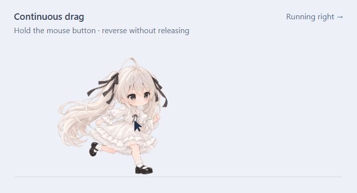

# Codex Desktop Pet · 可自定义桌宠插件

作者: **CharlesQueen**

[English](README.md) · 简体中文

为 Codex 提供透明桌面浮窗、原始分辨率动画和工作状态自动联动的可自定义桌宠插件。


图中角色仅为一个示例资源包，插件名称及控制机制不绑定该角色。图片权利说明见 [assets/RIGHTS.md](assets/RIGHTS.md)。

## 0.2.2 更新与问题修复

- **新增插件管理窗口**：右键桌宠或托盘图标，选择“插件管理”，即可查看安装状态、版本和来源目录，打开 Codex 中的插件记录，或卸载插件。卸载会停止桌宠并移除注册和缓存，保留本地设置与项目图片。
- **隐藏后保持隐藏**：修复新插件连接建立时桌宠重新弹出的问题。隐藏选择会跨工作事件、新会话及 Codex 重启保留，直到从托盘主动显示，或运行 `pnpm desktop:start` 恢复。
- **退出后不再自动唤起**：修复选择“退出桌宠”后又随工作连接重新启动的问题。退出会关闭浮窗和托盘进程，并保存退出选择，后续工作事件及连接不会重新打开它。运行 `pnpm desktop:start` 可主动打开并恢复自动启动；主动安装或更新也会打开桌宠。
- **窗口状态报告更准确**：修复重复启动时将仍在运行的共享窗口误标记为“已退出”的问题。多个连接继续共用同一浮窗，并遵守已保存的显示选择。

## 插件管理

从 **0.2.2** 起，右键桌宠或托盘图标，选择“插件管理”，即可查看安装版本和状态、打开 Codex 中的插件记录，或卸载插件。

卸载会关闭桌宠，并移除插件注册和缓存，保留本地设置及项目图片。在 Codex 中直接卸载插件后，桌宠浮窗也会退出。

也可以在项目文件夹中使用命令：

```powershell
pnpm plugin:status
pnpm uninstall:plugin
```

## 0.2.1 更新重点

- **等待动画更连贯**：新增 6 张中间姿态，组成 20 帧歪头与回正循环，并修缮蕾丝细节、对齐角色位置。
- **空闲注视范围扩大**：鼠标移动到窗口周围也能触发注视，默认大小下向窗口外延伸约 40 像素；工作动画仍优先显示。
- **持续拖动也能转身**：按住鼠标途中反向移动，超过少量防抖距离就会切换跑步朝向，无须松开鼠标或越过最初的按下位置。

### 等待动画


### 连续拖动与转身



拖动示例使用实际桌宠渲染代码和脚本模拟的鼠标轨迹录制。GIF 为缩小后的演示，安装后的动画仍使用 **1422 × 1117** 画布。

## 功能

- Windows 透明置顶浮窗；拖动移动，通过 **Ctrl + 滚轮** 或 **− / +** 调整大小。
- 本地插件连接后自动出现（已选择隐藏或退出时除外），多个连接共享同一浮窗，最后一个连接结束后自动退出。
- 根据本地 Codex 生命周期回调切换工作、等待、结束和失败状态，也可以通过 MCP 工具设置临时动作。
- 九种标准动作及十六个注视方向；示例共包含 112 帧播放画面，其中等待动画含 6 张生成的中间态图片，用于去程和回程，统一画布为 **1422 × 1117**。
- 角色与服饰由 `assets/manifest.json` 配置；面板及托盘菜单支持中英文切换。
- **Escape** 只收起控制栏；关闭浮窗会隐藏到托盘，通过“退出桌宠”结束程序。

插件使用独立的本地动画窗口，不替换内置 **Show pet**。目前实测平台为 Windows。自动联动需要支持本地插件生命周期回调的 Codex 主机；云端 Work 环境不提供相同的本地回调连接。

## 下载与安装

下载 [最新版本](https://github.com/CharlesQueen/codex-desktop-pet/releases/latest)，或克隆仓库。下载包包含源码及现有图片资源，不是免安装的独立程序。

需要 Windows、Node.js 22.12 或更高版本、pnpm 11，以及支持本地插件的 Codex 桌面客户端。

```powershell
git clone https://github.com/CharlesQueen/codex-desktop-pet.git
cd codex-desktop-pet
powershell -NoProfile -ExecutionPolicy Bypass -File scripts/install.ps1
```

安装脚本会安装依赖、显式下载 Electron 运行程序、配置项目路径、构建并注册插件，然后立即打开桌宠，无须等待 MCP 连接。只有收到本次启动后的可见窗口及图片绘制报告，才会提示成功。启动诊断保存在 `.local/desktop/startup.log`。已安装插件会使用此项目的运行环境，请保留项目目录。

重新加载 Codex，并在提示时启用生命周期回调，即可开始自动跟随工作状态。首次安装的窗口在没有连接时保持显示；MCP 连接后接管同一个窗口，此后最后一个连接结束时自动退出。再次显示可运行 `pnpm desktop:start`；前台调试可运行 `pnpm desktop`；`pnpm preview` 会输出本地面板预览地址。

仅执行 `codex plugin add` 只会注册插件，不会执行本安装脚本或立即显示窗口。需要“装好就出现”时，请使用上面的安装命令（克隆后也可运行 `pnpm run setup`）。

## 操作与语言

右键角色或托盘图标，可选择自动跟随、预览动作、服饰和“语言 → English / 中文”。会话面板有独立的语言选择器。服饰列表来自资源清单；当前仅随附白裙示例。

`pet_open` 返回会话 ID，后续调用 `pet_status` 和 `pet_set_state` 时保留该 ID，避免不同聊天互相影响。`running` 表示专注工作，`running-left` 和 `running-right` 表示移动；`mode: "auto"` 用于结束临时动作并恢复自动跟随。

## 持续隐藏与退出

选择**持续隐藏，手动显示后恢复**后，工作事件、新会话连接及 Codex 重启都不会让桌宠自行显示。点击托盘图标或选择**显示桌宠**即可恢复。

选择**退出桌宠，并停止自动唤起**会关闭浮窗与托盘进程，并阻止自动重启。在项目目录运行 `pnpm desktop:start` 可主动重新打开，并恢复自动启动。会话面板中的 `pet_open` 与桌面浮窗独立，不会取消隐藏或退出选择。主动安装或更新也会打开桌宠。

## 添加自己的角色或服饰

1. 在 `assets/<pack-id>/` 中放置 `<state>.png` 动画 PNG 和 `<state>-still.png` 静帧。所有动作应共享画布尺寸与角色定位。
2. 在 `look/` 中提供 `00.png` 至 `15.png`，从正上方开始按顺时针排列。
3. 在 `assets/manifest.json` 的 `outfits` 中添加 `id`、中文 `label` 和英文 `label_en`，通过 `default_outfit` 选择初始资源包。
4. 根据实际资源更新 `canvas`、帧数、帧时长和 SHA-256 元数据，再重新构建插件。

状态名称为 `idle`、`running-right`、`running-left`、`waving`、`jumping`、`failed`、`waiting`、`running`、`review`、`looking`。随附示例前九种状态共 96 帧播放画面，注视方向共 16 帧。目前所有资源包共享清单中的画布与动画元数据。

## 已安装旧版，如何更新

先退出 Codex，并在托盘菜单中选择“退出桌宠”。在原来的仓库目录打开 PowerShell，获取更新：

```powershell
git pull --ff-only
```

成功后刷新已安装的插件：

```powershell
powershell -NoProfile -ExecutionPolicy Bypass -File scripts/update.ps1
```

更新会重新构建插件、替换安装缓存，然后打开新版桌宠。窗口设置和本地会话数据保留在 `.local` 中；重新打开 Codex 后恢复工作状态自动联动。仅拉取 GitHub 代码不会刷新已安装插件的缓存。

通过 ZIP 安装的用户，可将新版源码覆盖到原目录，保留 `.local`，再执行同一更新命令。有自行修改源码的用户，请先提交或暂存自己的改动，再拉取更新。

## 开发与验证

版本号以最新正式发布版本为基准连续递增，开发过程中的修改不占用版本号。

```powershell
pnpm test
pnpm desktop:test
pnpm test:lifecycle
pnpm test:visibility
pnpm test:pointer
pnpm test:update
pnpm exec playwright install chromium
pnpm test:browser
pnpm format
```

检查覆盖会话隔离、回调并发写入、明确的失败状态、MCP 图片传输、原生窗口操作、连接生命周期和中英文面板。原生窗口测试会打开独立测试浮窗。运行状态、测试截图、本机路径、依赖和生成的发布目录不纳入 Git。

源码提供中英文注释；错误直接报告，不静默吞掉。并发同步与协议契约属于正常功能实现。

## 仓库权限

任何人均可按许可证下载或复制本仓库。只有作者明确邀请的协作者可以提交合并请求。原仓库的分支创建、更新、删除及合并仅由作者执行，自动合并关闭；受邀协作者不能绕过分支限制。

## 许可证与责任声明

原创代码及文档采用 [PolyForm Noncommercial 1.0.0](LICENSE.md)。项目属于**源码可用、仅限非商业用途**的软件，不是 OSI 定义的开源项目。允许按许可证进行非商业修改与分享，并保留必要声明；不允许商业使用。示例图片及第三方 IP 适用 [独立权利说明](assets/RIGHTS.md)。

本项目仅供非商业学习、交流与分享。对于他人违反许可证或侵犯第三方权利的使用行为及其后果，作者概不承担任何责任。

版权声明及对应英文表述见 [NOTICE.md](NOTICE.md)。
